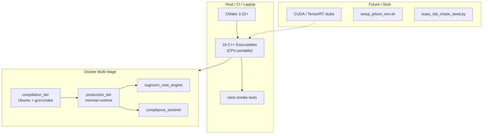
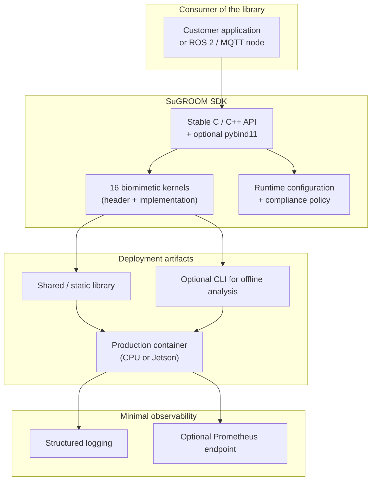

# Architecture — Project SuGROOM Ecosystem

**Status:** Reflects the verified current state of the repository plus recommended target architecture for an industrial MVP.

---

## 1. Current Architecture (verified)

### Component inventory (current)

| Layer | Status |
|-------|--------|
| Frontend / UI | None |
| Backend / API | None (console only) |
| Data layer | None (in-memory mock vectors) |
| Authentication | None |
| Billing | None |
| Notifications | None |
| Analytics | None |
| Background jobs | None |
| Object storage | None |
| Real-time | None |
| Observability | Console `std::cout` only |
| Backups / DR | None |

### Deployment options present

- Local CMake + ctest  
- Docker multi-stage  
- Fly.io (`fly.toml`)  
- Multiple cloud CI starters (AWS, Azure, Google, IBM, Docker publish, CodeQL)

---

## 2. Target Architecture for Industrial MVP

### Build-vs-buy decisions

| Capability | Decision | Rationale |
|------------|----------|-----------|
| Core kernels | Build (keep pure C++) | Domain IP; already present |
| Packaging / SDK | Build (CMake install + Conan/vcpkg) | Standard industrial practice |
| Container base | Buy (official Ubuntu / NVIDIA Jetson images) | Security & maintenance |
| Telemetry transport | Buy / adopt (ROS 2, MQTT, OPC UA) | Do not invent a new protocol |
| Auth / multi-tenant | Out of scope for this repo | Belongs to a future control-plane product |
| Billing / Stripe | Out of scope for this repo | Quote-based commercial model only |
| Secrets management | Use platform secrets (Fly, cloud KMS) | Never hard-code |

---

## 3. Data flow (current simulation path)

1. Host process constructs a `std::vector` of mock actuator telemetry.  
2. Kernel function (sin/cos-based attenuation or equivalent) transforms the vector in-place or into an output buffer.  
3. Result is printed or returned; process exits.  

No persistence, no network, no multi-process coordination.

---

## 4. Security & compliance posture (current + required for MVP)

- **Current:** Console-only, no network surface, root Docker containers.  
- **MVP requirements:**
  - Non-root container user  
  - Explicit export-control / geofence policy evaluation before any real actuation path is enabled  
  - Clear documentation that proprietary coefficients are not in the public tree  
  - SBOM generation in CI  
  - Dependency and container scanning  

---

## 5. Future optional layers (explicitly non-goals for current MVP)

- Multi-tenant SaaS control plane  
- Web dashboard  
- Children’s learning portal  
- Market-data or industrial telemetry SaaS integrations  

These would live in separate repositories that *consume* the SuGROOM library.
